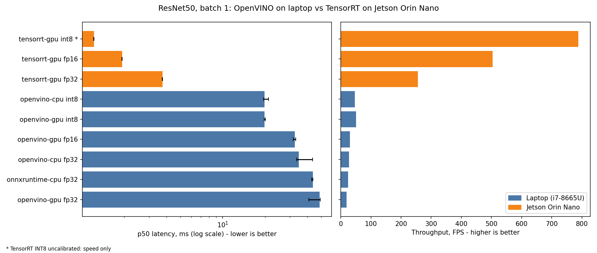

# ResNet50: OpenVINO on a laptop vs TensorRT on a Jetson Orin Nano

I took ResNet50, exported it once to ONNX, and benchmarked it with **OpenVINO** on an
Intel laptop and **TensorRT** on an NVIDIA Jetson Orin Nano, each on the hardware it
was designed for. All code, result summaries and commit history are in this repo.



## Results (batch 1, median of 3 rounds)

| System | Config | p50 (ms) | FPS | Power (W) | FPS/W |
|---|---|---|---|---|---|
| Jetson Orin Nano | TensorRT INT8 * | 1.22 | 788 | 17.1 | 46.1 |
| Jetson Orin Nano | TensorRT FP16 | 1.93 | 503 | 19.8 | 25.5 |
| Jetson Orin Nano | TensorRT FP32 | 3.74 | 256 | 21.0 | 12.2 |
| Laptop (i7-8665U) | OpenVINO CPU INT8 | 19.80 | 46 | | |
| Laptop (i7-8665U) | OpenVINO GPU INT8 | 19.80 | 51 | | |
| Laptop (i7-8665U) | OpenVINO GPU FP16 | 32.51 | 30 | | |
| Laptop (i7-8665U) | OpenVINO CPU FP32 | 34.73 | 27 | | |
| Laptop (i7-8665U) | ONNX Runtime CPU FP32 | 43.70 | 24 | | |
| Laptop (i7-8665U) | OpenVINO GPU FP32 | 48.78 | 20 | | |

\* The TensorRT INT8 engine was built without calibration data, so it is a **speed
measurement only** (accuracy not valid). Full table with per-round ranges and p95:
[`results/summary.md`](results/summary.md).

## Findings

- **TensorRT on the Orin Nano is roughly 9-17x faster than the laptop**, depending on
  precision (FP32 ~9x, FP16 ~17x, INT8 ~16x vs. the laptop's median p50). This compares two
  different hardware classes, not just two runtimes.
- **INT8 helps a lot on both machines.** On the laptop, OpenVINO INT8 was ~1.75x faster
  than FP32 on CPU and ~2.5x faster than FP32 on the iGPU, with no accuracy loss on my test set.
- **OpenVINO beats ONNX Runtime on the same CPU**: about 20% lower latency (34.7 vs 43.7 ms).
- **The iGPU defaults to FP16.** FP16 was ~1.5x faster than FP32 on the UHD 620.
- **Efficiency on the Jetson improves with lower precision**: FPS per watt rises about 4x
  from FP32 to INT8 (12 -> 46), because INT8 is both faster and draws less power.
- **The Jetson is much more consistent**: its rounds agree within about 1%, while the laptop
  showed outliers (up to ~25% between rounds), probably thermal and background activity.

## Method

- Same model everywhere: torchvision ResNet50 (`IMAGENET1K_V2`) exported to ONNX (opset 18;
  the exporter upgraded my requested 17). `models/resnet50.onnx.sha256` has checksums for
  both `resnet50.onnx` and its weights file `resnet50.onnx.data`.
- Batch 1, random float32 input, 224x224. Latency includes input/output copies.
- Laptop: 50 warmup + 500 timed iterations per config, 3 rounds with a 90 s cooldown.
  Execution precision is pinned (`INFERENCE_PRECISION_HINT`) so "FP32" really runs FP32.
- Jetson: `trtexec`, 500 ms warmup + 500 iterations, 3 rounds; latency = `latencyMs`
  (H2D + compute + D2H). Engines built with `trtexec` (FP32, FP16, INT8+FP16).
- FPS = 1000 / mean latency, so it does not convert exactly from p50.
- INT8 on the laptop: NNCF post-training quantization with 300 Imagenette training images.
- Accuracy: top-1 on 500 Imagenette validation images (1000-way ImageNet head): 79.6% for
  CPU FP32/INT8 and GPU FP32/FP16, 80.2% for GPU INT8 (see `results/accuracy_by_config.md`).
- Power (Jetson only): `tegrastats` `VDD_IN` (whole-module input power) averaged over 30 s
  of load while the GPU was busy. Idle baseline with the desktop running was 7.8 W. Laptop
  power was **not** measured.

## Hardware and software

| | Laptop | Jetson |
|---|---|---|
| Device | Intel Core i7-8665U (4C/8T), UHD Graphics 620, 15.8 GB RAM | Jetson Orin Nano Developer Kit (Super), 8 GB |
| OS | Windows 11 Pro, Best Performance power mode, plugged in | L4T R36.5.0, MAXN_SUPER, `jetson_clocks` |
| Runtime | OpenVINO 2026.4.1, ONNX Runtime 1.32.0, Python 3.11.9 | TensorRT 10.3.0.30 |

## Caveats

- Different hardware classes: results show "best of Intel laptop" vs "best of NVIDIA edge",
  not a like-for-like runtime comparison.
- TensorRT INT8 is uncalibrated (speed only). A calibrated TensorRT INT8 model is future work.
- Single model, single batch size, synthetic input for timing; small accuracy test set (500 images).
- The laptop's power consumption was not measured, so FPS/W is Jetson-only.

## Reproduce

Laptop (Windows PowerShell):
```powershell
python -m venv .venv; .venv\Scripts\Activate.ps1
pip install -r requirements-laptop.txt
python scripts\export_onnx.py
python scripts\convert_ov.py
# download Imagenette to data\ (see scripts\quantize_ov.py), then:
python scripts\quantize_ov.py
.\scripts\run_all.ps1
```
Jetson (copy `models/resnet50.onnx` and `.onnx.data` first, then verify the checksum):
```bash
sha256sum -c <(tr -d '\r' < models/resnet50.onnx.sha256)
sudo jetson_clocks
bash scripts/build_trt.sh
bash scripts/run_all.sh
bash scripts/power_trt.sh && python3 scripts/parse_power.py
```
Combine everything (on the laptop): `python scripts\aggregate.py`
